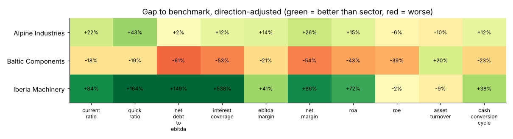

# Financial Statements Analyzer

Ratio analysis of three companies in a Jupyter notebook: liquidity, leverage, profitability and DuPont decomposition of ROE, compared with a sector benchmark.



## What it does

- **Liquidity**: current, quick and cash ratios
- **Leverage and debt service**: debt / equity, net debt / EBITDA, interest coverage, debt / assets
- **Profitability**: gross, EBITDA, EBIT and net margins, ROA, ROE
- **Efficiency**: asset turnover, DSO, DIO, DPO and cash conversion cycle
- **DuPont analysis**: 3-step and 5-step decomposition of ROE (tax burden, interest burden, EBIT margin, asset turnover, equity multiplier), checked to reproduce ROE exactly
- **Benchmark comparison**: each ratio compared with a sector value, with a direction-aware verdict (better / in line / worse), since a lower debt ratio is good and a lower margin is not
- Written conclusions on each company's strengths and weak points

## Quick start

```bash
pip install -r requirements.txt
jupyter notebook notebooks/financial_analysis.ipynb
pytest
```

The notebook is already executed, so charts and tables are visible on GitHub without running anything.

## Use your own data

Replace `data/financials.csv` with one row per company and year, using the same columns (revenue, COGS, EBITDA, D&A, EBIT, interest, tax, net income and the main balance sheet lines). `data/benchmark.csv` holds the benchmark value for each ratio.

## Project structure

```
fsa/ratios.py                      Ratio, DuPont and benchmark functions
notebooks/financial_analysis.ipynb Executed analysis with charts and conclusions
data/financials.csv                Sample statements, 3 companies x FY2023-FY2025
data/benchmark.csv                 Sector benchmark ratios
scripts/make_sample_data.py        Generator of the sample statements
tests/                             Unit tests (hand-computed ratios, DuPont identity, data consistency)
```

## Data and limits

- The three companies and the benchmark are **fictional and illustrative**. The generator builds consistent statements: the balance sheet balances and equity rolls forward with net income and dividends.
- Ratios use year-end balance sheet values, not averages.
- A benchmark of this kind should come from a real peer group (for example median of listed peers) when used on actual companies.

## Stack

Python · pandas · NumPy · Matplotlib · Jupyter · pytest
